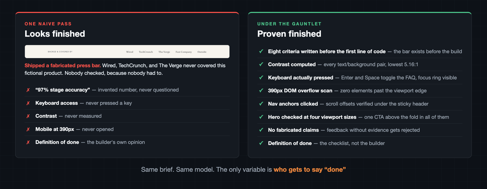

# Gauntlet Mini

[](LICENSE)
[](#setup)
[](https://github.com/cyog941/gauntlet-mini/stargazers)

The gauntlet loop with a mini bill. Workers build, critics judge the work against a written quality bar, and the loop runs inside a budget you pick before anything starts: 50% of your usage window, then 75%, then 95%, each step only with your consent. Mini refers to what it spends, never to what it builds.

The loop's famous demos are also famous for their bills. Viral runs of the original prompt burned $1,200 to $1,700 in tokens on single builds, and the most upvoted community verdict on the whole trend is blunt: "guaranteed token burn with fingers-crossed results." This version keeps the quality machinery and removes the open-ended spend.

The whole idea in one sentence: instead of telling your agent "make it amazing" and hoping, you make it write down what good means first, then run builders and critics against that bar until you accept the work or the budget says stop.

It ships in the standard `SKILL.md` agent-skill format, with a self-contained prompt port for agents that don't load skills. Nothing here is tied to one vendor.

## Where this comes from

None of this is an original idea, and pretending otherwise would be silly. The lineage:

**Matt Shumer** named the gauntlet loop and wrote the prompt that made it famous, while building his viral [Claude of Duty](https://github.com/robonuggets/gauntlet-loop) demo. His core insight is the part worth stealing even if you ignore the rest of this repo: an agent grading its own work drifts toward "good enough," so you give the critic fresh context, a concrete reference to compare against, and a binary choice instead of a score. Jay E at [RoboNuggets](https://github.com/robonuggets/gauntlet-loop) later packaged that prompt into a widely shared skill.

Underneath that sit two of the workflow patterns from Anthropic's [Building Effective Agents](https://www.anthropic.com/engineering/building-effective-agents) essay from December 2024: orchestrator-workers, where a lead agent splits a task and delegates the pieces, and evaluator-optimizer, where a generator and a critic trade drafts and feedback in a loop.

And those are old engineering ideas wearing new clothes. Test-driven development writes the test before the code. Code review works because the author never approves their own pull request. A construction site runs on a punch list: inspectors walk the job with a written list of defects, and nothing gets handed over until the list is clear. This skill is those habits, applied to a fleet of AI agents.

What this version adds: a hard usage budget you pick before anything runs, model tiering so cheap models handle the grunt work, ownership rules so parallel workers never fight over the same file, and an evidence hierarchy that ranks what critics are allowed to count as proof.

## Receipts, not vibes

We ran the same one-line brief ("build a landing page for a fictional sleep-tracking ring") through the same model twice: once as a naive single pass, once under the gauntlet's rules. Both outputs look respectable. That is exactly the point: looks are not the difference.



The press bar in that graphic is a real crop from the naive build: it invented coverage by Wired, TechCrunch, and The Verge for a product that does not exist, because nothing in a single pass ever asks "says who?" The gauntlet build could not do that, since its critic rejects any claim that cannot point to evidence.

## The known flaw in the original, and what this version does about it

The most-shared critique of the gauntlet loop: it only works when a real-world reference exists to compare against. Claude of Duty had Call of Duty. Point the original prompt at something novel and the blind critic invents an arbitrary standard, then burns tokens chasing it. "Make it utterly perfect" becomes, as one Redditor put it, the new "make no mistakes." Even the famous demo never actually passed its own bar: the critic scored it 3.6 out of 10, days of looping pushed that to 5.1, and the run was stopped by hand.

This version's answer is structural. A grounding phase establishes a validated baseline before any fan-out, so the fleet always sharpens a real target. Subjective quality gets translated into observable criteria, because "iterate until it's amazing" is a budget with no bottom. And three stop rules replace "utterly perfect": stop when you accept the result, stop when a cycle fixes nothing, stop when the budget share is spent.

## Why bother

One long pass gets you one unchecked draft. The failure mode is predictable: models are lenient graders of their own output, so "review your work and fix any issues" mostly produces a confident paragraph about how few issues there were.

The gauntlet splits the roles. Builders build. A separate critic, with no memory of the build decisions, checks the result against criteria that were written down before the first line of work. When a check fails, the failure goes back to the worker that owns that piece, with the evidence attached: the failing test output, the screenshot, the unsupported claim. Then another cycle runs. The loop is bounded, so it converges instead of wandering forever.

## How it works

Seven steps, and the reasoning behind each one:

1. **Pin the brief.** The skill extracts what you want, what done means, and what materials exist, and asks you whatever it needs so it isn't guessing. Anything still assumed after that is labeled.

2. **Get the direction right before the fleet arrives.** If there's no existing draft or plan, it researches what exists and one strong solo pass establishes the target first. If the direction is still unclear, it asks you rather than picking one. This matters more than anything after it: the gauntlet sharpens a sound target, and every worker-hour spent polishing the wrong thing is pure waste.

3. **Split by ownership.** Usually 2 to 4 workers, each with one objective and exclusive ownership of its files or sections. The reason is mechanical, not philosophical: two agents editing the same artifact in the same cycle produce conflicts that cost more to untangle than the parallelism saved.

4. **Write the tests before the build, ranked by evidence strength.** Deterministic checks come first (compilers, test suites, schema validators: cheap, binary, and impossible to argue with). Then execution evidence: actually run the thing, render it, click through it. Then comparison against reference material. Judgment calls against a written rubric come last, and a critic's opinion never overrules a passing test or substitutes for one that could have been run. Feedback that can't point to evidence gets rejected outright.

5. **Right-size the brainpower.** The strongest model handles direction and the final verdict, because a wrong call there wastes the entire fleet's work. Well-specified implementation and research sweeps run on cheaper, faster models. Spending top-model tokens on work the spec already thought through buys nothing except a bigger bill against your usage limit.

6. **Loop with a leash.** After every cycle you see the result and how many Must and Should checks still fail, and you decide whether another cycle runs. The checklist, the cycle count and the failing counts live in a `gauntlet-state.md` file, so a long run doesn't lose track when the conversation gets summarized. The loop stops honestly when a cycle changes nothing, because a cycle that fixes nothing is a signal that the spec or the inputs are the problem, not the effort.

7. **Assemble and re-verify the whole.** Pieces that pass separately can still fail together, so the final step runs the full evaluation order on the integrated result, then reports what passed, what changed across cycles, and anything still unresolved. Hidden failures are treated as lying.

## The budget: read this before running it

This skill spends your usage limit fast. Running several agents multiplies token spend. That's the point, and it's also the cost, so the skill refuses to start without a budget.

The budget is a share of your remaining usage window (most plans meter usage in 5-hour rolling windows). Two ways to set it:

Tell the agent up front, in the same message as your request:

> `/gauntlet-mini build me a landing page for my product, use 50% of my session/token limit as a hard stop to complete this build`

Or say nothing and let it ask. Before spinning anything up, it offers three tiers:

| Tier | When to pick it |
|------|-----------------|
| 50%, the recommended start | Most builds. Leaves half your window for everything else. |
| 75% | Bigger builds, or a second pass after a 50% run got close. |
| 95% | A maximum-quality run. Assume the window is spent afterward. |

Start at 50%. If the result isn't there when the budget runs out, the skill stops, shows you what the spend bought, and offers the next rung: 50%, then 75%, then 95%. It never escalates on its own, and it never plans past 95%. Check what's left of your window with your agent's usage command (typically `/usage` or `/status`).

## Setup

Pick your agent. Each one gets the same technique; only the packaging changes.

### Add to Claude Code

One command via [skills.sh](https://skills.sh):

```bash
npx skills add cyog941/gauntlet-mini
```

Or clone it straight into the skills folder:

```bash
git clone https://github.com/cyog941/gauntlet-mini.git ~/.claude/skills/gauntlet-mini
```

Open a new session and it's available as `/gauntlet-mini`. This also works for any other agent that reads the `SKILL.md` agent-skill format: point the clone at that agent's skills folder instead.

### Add to Codex

Codex has no skill loader, but any markdown file in `~/.codex/prompts/` becomes a slash command. A self-contained port lives in [`codex/gauntlet-mini.md`](codex/gauntlet-mini.md):

```bash
mkdir -p ~/.codex/prompts
curl -fsSL https://raw.githubusercontent.com/cyog941/gauntlet-mini/main/codex/gauntlet-mini.md \
  -o ~/.codex/prompts/gauntlet-mini.md
```

Restart Codex and run `/gauntlet-mini <your request>`. One difference: with no parallel subagent tool, workers run as sequential ownership-bounded passes by default, or as real workers via `codex exec -m <model>` when shell access allows.

### Add to Gemini CLI

Gemini CLI loads custom commands from TOML files in `~/.gemini/commands/`. A port lives in [`gemini/gauntlet-mini.toml`](gemini/gauntlet-mini.toml):

```bash
mkdir -p ~/.gemini/commands
curl -fsSL https://raw.githubusercontent.com/cyog941/gauntlet-mini/main/gemini/gauntlet-mini.toml \
  -o ~/.gemini/commands/gauntlet-mini.toml
```

Restart Gemini CLI and run `/gauntlet-mini <your request>`. Same sequential-pass adaptation as Codex.

### Add to Hermes or any other agent

[`codex/gauntlet-mini.md`](codex/gauntlet-mini.md) doubles as the portable, self-contained version. Drop it wherever your agent takes custom prompts or instructions: its prompt or command folder if it has one, otherwise its `AGENTS.md`-style instruction file. Adjust the budget wording to whatever usage limits that agent has. The technique itself ports anywhere an agent can run bounded sub-tasks.

## Good fits and bad fits

Use it for substantial builds where good is checkable: a landing page, an app feature, a research report, a deck. Use it to improve an existing thing without changing its direction, like an audit-and-fix pass across design and performance. Use it for research that splits naturally, several competitors or several markets, with one synthesis at the end.

Skip it for small, tightly scoped changes. A one-line fix doesn't need a committee, and the skill will say so and just do the work with one agent. Same for work so intertwined that parallel workers would collide on the same file.

Two habits make it work better. Give it your raw materials: briefs, examples, links, an existing draft. The gauntlet sharpens a target; it doesn't guess one. And say what must be true for you to accept the result, because concrete must-haves become the tests. If you want the plan without the run, say "convert this to a gauntlet prompt" and you get a copy-ready prompt instead of an execution.

## What's in the repo

```
gauntlet-mini/
├── SKILL.md                        # the agent skill (standard SKILL.md format)
├── codex/
│   └── gauntlet-mini.md            # self-contained portable port (Codex custom prompt)
├── gemini/
│   └── gauntlet-mini.toml          # Gemini CLI custom-command port
└── references/
    ├── evaluator-patterns.md       # what counts as evidence, by discipline
    └── conversion-examples.md      # worked examples of good and bad gauntlet fits
```

## License and credit

[MIT](LICENSE). The gauntlet loop technique and its name are Matt Shumer's; the underlying workflow patterns are described in Anthropic's [Building Effective Agents](https://www.anthropic.com/engineering/building-effective-agents). This repo is an independent implementation that adds the budget ladder, model tiering, ownership rules, and the evidence hierarchy.
